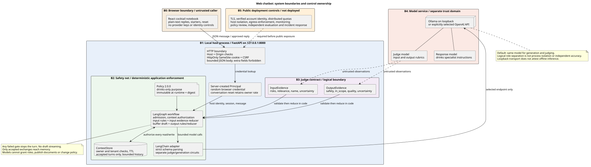

<div dir="rtl" align="right">

# دفتر نوشیدنی

<p dir="ltr" align="left"><a href="README.md">English</a></p>

این پروژه یک چت‌بات محلی درباره نوشیدنی‌هاست. رابط کاربری با <code dir="ltr">React</code> و بخش سرور با پایتون و <code dir="ltr">FastAPI</code> ساخته شده است. <code dir="ltr">LangChain</code> فراخوانی مدل‌ها را انجام می‌دهد. <code dir="ltr">LangGraph</code> درخواست را به عامل ترکیب یا تولید نوشیدنی می‌فرستد و مراحل بررسی سیاست، ارزیابی پاسخ و ذخیره گفتگو را اجرا می‌کند.

موضوع‌های مجاز شامل کوکتل، مواد اولیه، تجهیزات، تخمیر، شراب، آبجو، ویسکی و عرق سگی هستند. سیاست برنامه رد پرسش‌های نامرتبط و درخواست‌های ترکیبی را الزامی می‌کند. رابط کاربری فارسی راست‌به‌چپ است.

این پروژه برای آموزش است و محدودیت‌های شناخته‌شده دارد. در ارزیابی ثبت‌شده فارسی، مدل و داور یک دستور اشتباه برای نگرونی را پذیرفتند. درستی دستورها و تشخیص مهندسی اجتماعی همچنان به مدل وابسته است. ممیز اختیاری نیز در آزمون زنده، پاسخ‌های درست را به‌اشتباه مسئله‌دار تشخیص داد. در یک گفتگوی چندمرحله‌ای، پرسش نامرتبط و پاسخ رد آن به‌اشتباه در تاریخچه پذیرفته‌شده ذخیره شدند. پیش از استقرار، [گزارش فعلی آزمون‌ها](docs/multi-agent-validation.md) و [مرزهای امنیتی](docs/security.md) را بخوانید.



برای شروع، [نمای کلی سامانه](docs/diagrams/13-l0-system-context.svg)، [اجزا و مرزهای داخلی](docs/diagrams/14-l1-runtime-components.svg) و [روند عملکرد گفتگو](docs/diagrams/15-functional-flow.svg) را ببینید. [فهرست نمودارها](docs/diagrams/README.md) منابع قابل ویرایش و یک نمایشگر آفلاین نیز دارد.

## اجرا با مدل محلی

از پایتون نسخه ۳٫۱۲ یا ۳٫۱۳، <code dir="ltr">Node.js 26</code>، <code dir="ltr">npm</code>، <code dir="ltr">uv</code> و <code dir="ltr">Ollama</code> استفاده کنید. دستورهای زیر را در پوشه اصلی مخزن اجرا کنید:

<div dir="ltr" align="left">

```sh
ollama pull gemma3:4b
./scripts/start.sh
```

</div>

نشانی <a href="http://127.0.0.1:8000" dir="ltr">http://127.0.0.1:8000</a> را باز کنید. اسکریپت وابستگی‌های قفل‌شده را نصب می‌کند و رابط کاربری را می‌سازد. سپس در صورت نیاز <code dir="ltr">Ollama</code> و بعد سرور را اجرا می‌کند. نیازی به داکر نیست.

برای توقف پردازش‌هایی که اسکریپت اجرا کرده است، <code dir="ltr">Ctrl+C</code> را بزنید. برای انتخاب مدل نصب‌شده دیگر، نام آن را به اسکریپت بدهید:

<div dir="ltr" align="left">

```sh
./scripts/start.sh gemma3:4b
```

</div>

اگر مدل نصب نباشد، اسکریپت پیام خطا می‌دهد و آن را خودکار دریافت نمی‌کند. گزارش راه‌اندازی مدل در پوشه محلی <code dir="ltr">reports/</code> قرار می‌گیرد. این پوشه وارد مخزن نمی‌شود.

## انتخاب زبان

زبان را از فهرست بالای گفتگو انتخاب کنید. این انتخاب، دکمه‌ها، پرسش‌های نمونه، خطاها، پاسخ‌های ثابت و زبان درخواستی پاسخ‌های بعدی را تغییر می‌دهد. پیام‌های قبلی ترجمه نمی‌شوند.

مرورگر انتخاب زبان را ذخیره می‌کند. در نخستین استفاده، مرورگری با زبان فارسی، رابط فارسی را نمایش می‌دهد. جهت متن هر پیام جداگانه تشخیص داده می‌شود. سرور فقط مقدارهای <code dir="ltr">en</code> و <code dir="ltr">fa</code> را در سرآیند <code dir="ltr">X-Chat-Language</code> می‌پذیرد.

برای آزمون دستی، از [پرسش‌های فارسی](chatbot-test-prompts-fa.txt) یا [پرسش‌های انگلیسی](chatbot-test-prompts.txt) استفاده کنید. هر فایل ده پرسش مثبت و ده پرسش منفی همراه با رفتار مورد انتظار دارد.

## مدل‌ها و استفاده در ترمینال

برای گفتگوی محلی در ترمینال، ابتدا سرویس مدل را اجرا کنید. سپس دستورهای زیر را وارد کنید:

<div dir="ltr" align="left">

```sh
uv sync --locked
uv run agentic-chat --provider local \
  --base-url http://127.0.0.1:11434/v1 --model gemma3:4b --language fa
```

</div>

راهنمای ترمینال انگلیسی است. دستور <code dir="ltr">/reset</code> گفتگو را پاک می‌کند. دستور <code dir="ltr">/quit</code> از برنامه خارج می‌شود. برای ارسال یک پیام، گزینه‌های <code dir="ltr">--message</code> و <code dir="ltr">--json</code> را اضافه کنید.

برای استفاده از سرویس <code dir="ltr">OpenAI</code>، کلید را از طریق محیط اجرا یا ابزار مدیریت اسرار در <code dir="ltr">OPENAI_API_KEY</code> قرار دهید. سپس اجرا کنید:

<div dir="ltr" align="left">

```sh
uv run agentic-web --provider openai --model gpt-4.1-mini
```

</div>

پیش‌فرض ترمینال، سرویس ابری و پیش‌فرض رابط وب، مدل محلی است. برنامه از کلید <code dir="ltr">API</code> استفاده می‌کند. ورود با حساب مرورگر <code dir="ltr">ChatGPT</code> در این برنامه پیاده‌سازی نشده است. کلیدها را در مخزن یا گفتگو قرار ندهید.

با گزینه <code dir="ltr">--judge-model</code> مدل داور را جداگانه انتخاب کنید. نشانی مدل محلی باید روی میزبان محلی باشد. متغیر <code dir="ltr">LOCAL_MODEL_API_KEY</code> از کلید سرویس ابری جداست. اگر سرور از طرح‌واره پاسخ ساختاریافته پشتیبانی نمی‌کند، گزینه <code dir="ltr">--structured-method json_mode</code> را به کار ببرید. هر دو حالت، ساختار پاسخ داور را بررسی می‌کنند.

## مراحل بررسی پیام

هر گفتگوی پذیرفته‌شده این مراحل را طی می‌کند:

۱. بررسی مالکیت، تعداد درخواست‌ها، ظرفیت، اندازه پیام، الگوهای شناخته‌شده اسرار و نویسه‌های کنترلی.

۲. بارگذاری زمینه مجاز و دریافت مشاهدات ساختاریافته از داور ورودی.

۳. تصمیم‌گیری بر اساس سیاست برنامه، بررسی برچسب موضوع و انتخاب یکی از دو عامل ترکیب یا تولید نوشیدنی برای نوشتن پیش‌نویس.

۴. بررسی پیش‌نویس و ارزیابی موضوع، ایمنی و کیفیت توسط داور خروجی.

۵. ذخیره و نمایش پاسخ، فقط پس از عبور از همه بررسی‌ها.

نام نامناسب، پاسخ خنثی دریافت می‌کند و برای خطاب‌کردن کاربر ذخیره نمی‌شود. خطای سرویس، داوری نامعتبر یا پایان مهلت، پاسخ ثابت ایجاد می‌کند. مدارشکن‌های جداگانه برای داور و تولید پاسخ، خطاهای تکراری و فراخوانی‌های کند را محدود می‌کنند. پیش‌نویس قبل از ارزیابی نمایش داده نمی‌شود.

[فایل سیاست](src/agentic_chat/policy.json) محدودیت‌ها و آستانه‌ها را تعیین می‌کند. گزینه <code dir="ltr">--policy PATH</code> فایل سیاست دیگری را هنگام راه‌اندازی می‌خواند. گزینه <code dir="ltr">--context-file PATH</code> یک سند را برای استفاده در ترمینال بررسی می‌کند. سند مشترک به فهرست خوانندگان مجاز در همان فضای سازمانی نیاز دارد.

سرور وب فقط به میزبان محلی متصل می‌شود. کوکی، نشست مرورگر را مشخص می‌کند و هویت واقعی شخص را تأیید نمی‌کند. استقرار عمومی به احراز هویت، ارتباط رمزگذاری‌شده، محدودیت ورودی، محدودیت مشترک درخواست‌ها و جداسازی شبکه نیاز دارد. حافظه و محدودیت‌های فعلی فقط در یک پردازش نگهداری می‌شوند. جزئیات در [مدل تهدید](docs/security.md) آمده است.

## عامل‌ها، حاکمیت و ممیزی

پنج نقش مبتنی بر مدل زبانی وجود دارد. هر نوبت پذیرفته‌شده سه فراخوانی مدل دارد: داور ورودی، یکی از عامل‌های تخصصی و داور خروجی.

| نقش | وظیفه |
| --- | --- |
| داور ورودی و مسیریاب | بررسی ایمنی و تشخیص موضوع درخواست فعلی؛ کد برنامه مسیر را اعتبارسنجی می‌کند. |
| عامل ترکیب نوشیدنی | کوکتل، نسبت مواد، روش ترکیب، سرو، نگهداری و معرفی کوتاه کاربر. |
| عامل تولید نوشیدنی | تخمیر، آبجوسازی، شراب، تولید نوشیدنی تقطیری و درخواست‌های ترکیبی تولید و کوکتل. |
| داور خروجی | بررسی همان پیش‌نویسی که قرار است نمایش داده شود؛ اجازه انتشار را کد صادر می‌کند. |
| ممیز پس از اجرا | بررسی نمونه‌های ساختگی ارزیابی، فقط با فعال‌سازی صریح. |

هر دو عامل تخصصی از مدل گزینه <code dir="ltr">--model</code> استفاده می‌کنند. گزینه <code dir="ltr">--judge-model</code> مدل داوران را تعیین می‌کند. عامل‌های تخصصی یک مدارشکن مشترک و داوران مدارشکن جداگانه دارند. عامل‌ها نمی‌توانند کار را به عامل دیگری بسپارند، مجوز بدهند، حافظه را بنویسند یا سیاست را تغییر دهند. این اختیارها در کد پایتون و سیاست نسخه ۲٫۱٫۰ قرار دارند.

ممیز مدارشکن و مهلت مستقل دارد و هم‌زمان فقط یک فراخوانی آن مجاز است. ممیزی از فرمان ارزیابی اجرا می‌شود و در گفتگوی وب فعال نیست. ورودی آن شامل پرسش ساختگی، پاسخ قابل مشاهده، اطلاعات مراحل و مرجع‌های موجود است. ممیز پیش‌نویس ردشده یا استدلال خصوصی داور را نمی‌بیند. همچنین نمی‌تواند پاسخ قبلی را پس بگیرد، برچسب مورد انتظار آزمون را عوض کند یا انتشار نسخه را تأیید کند.

برای آزمودن ممیز با نمونه‌های ثابت انگلیسی و فارسی، اجرا کنید:

<div dir="ltr" align="left">

```sh
uv run agentic-eval --live --suite audit --provider local \
  --base-url http://127.0.0.1:11434/v1 --model gemma3:4b \
  --audit-model gemma3:4b --output reports/audit.json
```

</div>

برای ممیزی پاسخ‌های تازه به پرسش‌های ساختگی، در همین دستور به‌جای مجموعه ممیزی از <code dir="ltr">--suite localization</code>، <code dir="ltr">regression</code> یا <code dir="ltr">holdout</code> استفاده کنید. برای هر نمونه، یک فراخوانی ممیزی نیز انجام می‌شود. گزارش، یکسان‌بودن مدل پاسخ‌دهنده و داور و ممیز را ثبت می‌کند. استفاده از یک مدل برای همه نقش‌ها، استقلال بررسی را ثابت نمی‌کند.

نتیجه ممیزی یکی از چهار حالت است: بدون یافته گزارش‌شده، نیازمند بررسی، نامشخص یا در دسترس نبودن ممیزی. شناسه‌های این حالت‌ها در گزارش به‌ترتیب <code dir="ltr">clear</code>، <code dir="ltr">review_required</code>، <code dir="ltr">inconclusive</code> و <code dir="ltr">unavailable</code> هستند. پاسخ پذیرفته‌شده بدون مرجع محتوایی، نامشخص باقی می‌ماند. خروجی نامعتبر یا خطای سرویس، شکست ممیزی محسوب می‌شود.

در مجموعه‌های گفتگو، هر نتیجه ممیزی غیر از حالت بدون یافته، کد خروج غیرصفر ایجاد می‌کند؛ شمار قبولی مستقل چت‌بات تغییر نمی‌کند. مجموعه اختصاصی ممیزی، یافته‌ها را با انتظار هر نمونه مقایسه می‌کند و کشف درست یک اشکال می‌تواند قبولی آزمون باشد.

این نمونه‌ها هنوز به بازبینی انسانی نیاز دارند. ممیز محلی فقط دو مورد از هشت آزمون را گذراند و برای تصمیم نهایی انتشار مناسب نیست. [نمودار حاکمیت و ممیزی](docs/diagrams/12-audit-governance.svg) و [نتایج اندازه‌گیری‌شده](docs/multi-agent-validation.md) جزئیات را نشان می‌دهند.

## توسعه و آزمون

برای ساخت دستی رابط کاربری، اجرا کنید:

<div dir="ltr" align="left">

```sh
uv sync --locked
npm --prefix frontend ci
npm --prefix frontend run build
uv run agentic-web
```

</div>

برای توسعه رابط، دستور <code dir="ltr">npm --prefix frontend run dev</code> را در ترمینال دیگری اجرا کنید. رابط توسعه روی درگاه ۵۱۷۳ اجرا می‌شود و درخواست‌ها را به سرور روی درگاه ۸۰۰۰ می‌فرستد.

آزمون‌های زیر به سرویس مدل نیاز ندارند:

<div dir="ltr" align="left">

```sh
uv run pytest --color=no
uv run behave --no-color --format progress
npm --prefix frontend test
uv run ruff check src tests features scripts
uv run ruff format --check src tests features scripts
uv run agentic-eval --output reports/offline.json
uv run agentic-eval --suite holdout --output reports/holdout.json
uv run agentic-eval --suite localization --output reports/localization.json
uv build
```

</div>

ابزار <code dir="ltr">Behave</code> سناریوهای <code dir="ltr">Gherkin</code> را از پوشه <code dir="ltr">features/</code> اجرا می‌کند. ارزیابی‌های اسکریپتی، اجرای سیاست را با داوری از پیش تعیین‌شده می‌سنجند. این آزمون‌ها دقت مدل را اندازه نمی‌گیرند.

برای ارزیابی با فراخوانی واقعی مدل محلی، اجرا کنید:

<div dir="ltr" align="left">

```sh
uv run agentic-eval --live --suite localization --provider local \
  --base-url http://127.0.0.1:11434/v1 --model gemma3:4b \
  --output reports/localization-live.json
```

</div>

ارزیابی زنده، داده‌های ساختگی آزمون را به سرویس انتخاب‌شده می‌فرستد. اگر انتظار آزمون برآورده نشود، برنامه با کد خطای غیرصفر پایان می‌یابد. گزارش‌ها شامل نتیجه و زمان اجرا هستند و متن گفتگو را ذخیره نمی‌کنند. شکست‌ها و محدودیت‌ها در [گزارش فعلی آزمون‌ها](docs/multi-agent-validation.md) و [نتایج پیشین زبان‌ها](docs/localization.md) ثبت شده‌اند.

## کد و مطالب آموزشی

- پوشه <code dir="ltr">src/agentic_chat/</code>: سیاست، زمینه، مدل‌ها، مدارشکن، گردش کار، ترمینال، سرور، ارزیابی و ممیزی.
- پوشه <code dir="ltr">frontend/</code>: رابط کاربری، ترجمه‌ها، آزمون‌ها و پیکربندی ساخت.
- پوشه‌های <code dir="ltr">tests/</code> و <code dir="ltr">features/</code>: آزمون‌های پایتون و سناریوهای پذیرش.
- [معماری](docs/architecture.md): الگوهای انتخاب‌شده و محل پیاده‌سازی آن‌ها.
- [نمودارها](docs/diagrams/README.md): منابع <code dir="ltr">PlantUML</code>، تصاویر و فایل‌های قابل ویرایش <code dir="ltr">Excalidraw</code>.
- [راهنمای آموزش](docs/teaching.md): نمایش‌های عملی و موضوع‌های بحث.
- [راهنمای مشارکت](AGENTS.md): قراردادهای مخزن و الزامات بازبینی.

بسته پایتون شامل بخش سرور است. فرمان وب به پوشه ساخته‌شده <code dir="ltr">frontend/dist</code> در مسیر کاری مخزن نیز نیاز دارد. اسکریپت <code dir="ltr">scripts/check_commit_message.py</code> پیام کامیت را بررسی می‌کند. آن را بدون حذف بررسی‌های موجود، از هوک <code dir="ltr">commit-msg</code> فراخوانی کنید.

</div>
