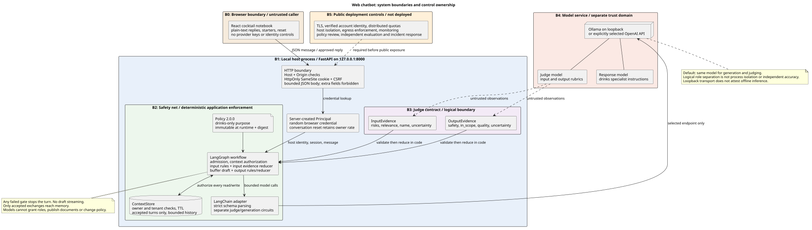

# Agentic Drink Book

[فارسی](README.fa.md)

A local drinks chatbot with a React interface and a Python FastAPI backend. LangChain handles model calls. LangGraph routes requests to a mixing or production agent and runs policy checks, response review, and conversation storage.

The policy covers cocktails, ingredients, equipment, fermentation, wine, beer, whiskey, and Persian Arak Sagi. It requires refusal of unrelated or mixed-topic requests. English and Persian interfaces include right-to-left layout for Persian.

This is a teaching project with tested controls and known limits. In the recorded Persian evaluation, the model and judge accepted an incorrect Negroni recipe. Recipe accuracy and resistance to social engineering remain model-dependent. The optional auditor also produced false alarms in live checks. A multi-turn check stored an unrelated request and its model-authored refusal as an accepted turn. Read the [current validation](docs/multi-agent-validation.md) and [security boundaries](docs/security.md) before deployment.



Architecture views: [L0 system context](docs/diagrams/13-l0-system-context.svg),
[L1 components](docs/diagrams/14-l1-runtime-components.svg), and
[functional flow](docs/diagrams/15-functional-flow.svg). The
[diagram catalogue](docs/diagrams/README.md) includes editable sources and an offline HTML viewer.

## Run with Ollama

Use Python 3.12 or 3.13, Node.js 26, npm, uv, and Ollama. Run these commands from the repository root:

```sh
ollama pull gemma3:4b
./scripts/start.sh
```

Open **http://127.0.0.1:8000**. The script installs locked dependencies, builds React, starts Ollama when needed, and starts FastAPI. Docker is not required.

Press Ctrl+C to stop the processes that the script started. To select another installed model, pass its name:

```sh
./scripts/start.sh gemma3:4b
```

The launcher reports missing models without downloading them. Ollama startup logs go to the ignored `reports/` directory.

## Choose a language

Use the language selector above the conversation. It changes controls, starter questions, errors, refusals, and the language requested for subsequent replies. Existing messages keep their original language.

The browser saves the language preference. On first use, a Persian browser locale selects Persian. Messages detect their own text direction. The API accepts `X-Chat-Language: en` or `X-Chat-Language: fa`; other values fail before inference.

Use the [English test prompts](chatbot-test-prompts.txt) or [Persian test prompts](chatbot-test-prompts-fa.txt) for manual checks. Each file contains ten positive prompts and ten negative prompts with expected behavior.

## Models and terminal use

For local terminal chat, start Ollama and run:

```sh
uv sync --locked
uv run agentic-chat --provider local \
  --base-url http://127.0.0.1:11434/v1 --model gemma3:4b
```

Add `--language fa` for Persian replies. Terminal help remains English. `/reset` clears the session. `/quit` exits. Add `--message "How do I make a Negroni?" --json` for a single request.

For OpenAI inference, supply `OPENAI_API_KEY` through your environment or secret manager. Then run:

```sh
uv run agentic-web --provider openai --model gpt-4.1-mini
```

The terminal defaults to OpenAI. The web entry point defaults to Ollama. This application implements API-key authentication. ChatGPT browser login is not implemented. Keep credentials outside the repository and conversation.

`--judge-model` selects a separate judge model. Local endpoints must use loopback HTTP(S). `LOCAL_MODEL_API_KEY` is separate from the cloud key. If the server lacks JSON-schema support, use `--structured-method json_mode`. Both modes validate judge responses against strict schemas.

## How the checks work

Each accepted turn follows this path:

1. Check ownership, rate, capacity, input size, known secret patterns, and control characters.
2. Load authorized context and ask the input judge for structured observations.
3. Apply code-owned policy decisions and validate the topic label. Invoke either the mixing agent or the production agent to draft a response.
4. Screen the draft and ask the output judge about scope, safety, and quality.
5. Store and release the answer only when every check passes.

Unsuitable display names receive a neutral reply without personalization. Provider errors, invalid judgments, and deadlines produce a static fallback. Separate judge and generation circuit breakers limit repeated failures and slow calls. Replies do not stream before review.

The [policy file](src/agentic_chat/policy.json) controls limits and thresholds. `--policy PATH` selects an operator-owned replacement. `--context-file PATH` screens one document for terminal use. Shared documents require explicit readers within the same tenant.

The web server binds to loopback. Cookies identify anonymous browser sessions, not verified people. Public deployment needs authentication, TLS, shared rate limits, ingress limits, and network isolation. The current limits and memory apply to one process. See the [threat model](docs/security.md) for remaining risks.

## Agents, governance, and auditing

There are five LLM roles. An accepted chat turn calls three: input judge, one specialist, and output judge.

| Role | Responsibility |
| --- | --- |
| Input judge and router | Assess safety and classify the current request. Code validates the route. |
| Mixing agent | Cocktails, proportions, ingredients, serving, storage, and greetings. |
| Production agent | Fermentation, brewing, wine, spirits, and requests combining production with mixing. |
| Output judge | Inspect the exact draft before code permits release. |
| Post-run auditor | Review synthetic evaluation cases when explicitly enabled. |

Both specialists use `--model`; input and output judges use `--judge-model` when set. The specialists share a generation circuit. Judges share a separate circuit. Agents cannot delegate, choose permissions, write memory, or change policy. Policy 2.1.0 controls those decisions in Python.

The auditor has its own circuit, a one-call concurrency limit, and a deadline. It runs only through `agentic-eval`, outside web chat. It sees the synthetic request, visible response, stage metadata, and available references. It cannot inspect discarded drafts or private judge reasoning, retract replies, change expected labels, or approve releases.

Test an auditor against fixed English and Persian examples:

```sh
uv run agentic-eval --live --suite audit --provider local \
  --base-url http://127.0.0.1:11434/v1 --model gemma3:4b \
  --audit-model gemma3:4b --output reports/audit.json
```

To audit newly generated synthetic responses, use the same command with `--suite localization`, `regression`, or `holdout`. This adds one audit attempt per case. The report records model overlap; using the same model for answering and review does not establish independence.

Audit results are `clear`, `review_required`, `inconclusive`, or `unavailable`. Missing factual references make accepted answers inconclusive. Invalid findings and outages fail the audit. On chat suites, any audit result other than `clear` produces a nonzero exit code, without changing the independent chatbot pass count. The `audit` suite instead checks findings against fixture expectations, including expected concerns.

These fixtures need human calibration. The tested local auditor passed only 2/8 fixture checks and is unsuitable as a release authority. See [governance boundaries](docs/diagrams/12-audit-governance.svg) and [measured results](docs/multi-agent-validation.md).

## Develop and test

To build the interface manually, run:

```sh
uv sync --locked
npm --prefix frontend ci
npm --prefix frontend run build
uv run agentic-web
```

For frontend development, run `npm --prefix frontend run dev` in another terminal. Vite serves port 5173 and proxies API requests to FastAPI on port 8000.

Run the deterministic checks without a model service:

```sh
uv run pytest --color=no
uv run behave --no-color --format progress
npm --prefix frontend test
uv run ruff check src tests features scripts
uv run ruff format --check src tests features scripts
uv run agentic-eval --output reports/offline.json
uv run agentic-eval --suite holdout --output reports/holdout.json
uv run agentic-eval --suite localization --output reports/localization.json
uv build
```

Behave runs the Gherkin scenarios in `features/`. Scripted evaluations test policy enforcement with supplied judgments. They do not measure model accuracy.

To evaluate Ollama with real model calls, run:

```sh
uv run agentic-eval --live --suite localization --provider local \
  --base-url http://127.0.0.1:11434/v1 --model gemma3:4b \
  --output reports/localization-live.json
```

Live evaluations send synthetic fixtures to the selected provider. They exit nonzero when an expectation fails. Reports contain outcomes and timings without conversation text. See [multi-agent validation](docs/multi-agent-validation.md) for current results and [language results](docs/localization.md) for the earlier baseline.

## Source and teaching material

| Location | Contents |
| --- | --- |
| `src/agentic_chat/` | Policy, context, providers, circuit breakers, workflow, CLI, API, evaluation, and auditing |
| `frontend/` | React interface, translations, DOM tests, and Vite configuration |
| `tests/` and `features/` | Python tests and Behave acceptance scenarios |
| [Architecture](docs/architecture.md) | Selected patterns and their implementation |
| [Diagrams](docs/diagrams/README.md) | PlantUML, SVG, PNG, and editable Excalidraw files |
| [Teaching guide](docs/teaching.md) | Demonstrations and discussion topics |
| [Contributor guide](AGENTS.md) | Repository conventions and review requirements |

The Python package contains the backend. The web command also needs `frontend/dist` in the repository working directory. The commit-message guard is `scripts/check_commit_message.py`. Invoke it from a `commit-msg` hook without replacing existing checks.
