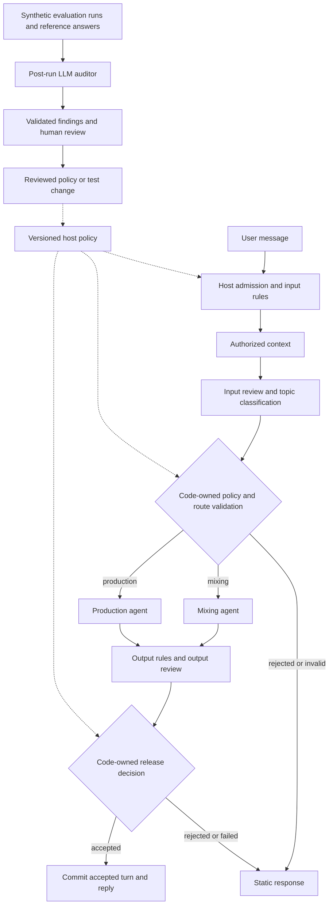

# Approved multi-agent design

Status: approved by the user on 2026-11-12 and implemented. The baseline below describes the pre-refactor code. See [current implementation and validation](multi-agent-validation.md) for results and remaining limitations.

## VERIFIED pre-refactor baseline

The current graph has seven stages and one response generator. An accepted turn calls the input judge, generator, and output judge. See [workflow.py](https://github.com/Iman/agentic-drink-book/blob/a10a9c1aef033b6d2cc08209989cb8b16e5210ab/src/agentic_chat/workflow.py#L65) and [its execution test](https://github.com/Iman/agentic-drink-book/blob/a10a9c1aef033b6d2cc08209989cb8b16e5210ab/tests/test_workflow.py#L19).

Fresh baseline checks on 2026-11-12 passed: 87 pytest tests, 30 Behave scenarios, and 174 steps, with no failures or skips. Commands:

```sh
uv run --no-sync pytest --color=no --junitxml=reports/multi-agent-baseline-pytest.xml
uv run --no-sync behave --no-color --format progress \
  --junit --junit-directory reports/multi-agent-baseline-bdd
```

Both commands used a writable temporary uv cache. Raw reports remain local. The working tree was clean before this proposal.

The current governance mechanisms include validated startup policy, deterministic decisions over judge evidence, and policy digests. The current audit is a bounded in-memory metadata deque. It excludes response text and does not call an LLM auditor. See [policy decisions](https://github.com/Iman/agentic-drink-book/blob/a10a9c1aef033b6d2cc08209989cb8b16e5210ab/src/agentic_chat/policy.py#L180) and [audit recording](https://github.com/Iman/agentic-drink-book/blob/a10a9c1aef033b6d2cc08209989cb8b16e5210ab/src/agentic_chat/workflow.py#L224). A fresh targeted run of `tests/test_governance.py` and `tests/test_workflow.py` passed 38 tests on 2026-11-12.

## PLAN

Use a bounded router with two specialist agents. Keep input and output review as mandatory LLM-as-judge roles. Add a separate post-run LLM auditor. This gives five LLM roles: four in the chat architecture and one in the evaluation path. An accepted chat turn still makes three model calls because it invokes only one specialist. Audit calls have a separate execution and usage budget.

| Role | Responsibility |
| --- | --- |
| Input reviewer and router | Return existing safety observations plus a constrained topic classification. Application code decides whether routing is allowed. |
| Mixing specialist | Cocktails, ingredients, proportions, serving, storage, and brief conversation setup. |
| Production specialist | Fermentation, brewing, wine, whiskey, Arak Sagi, production equipment, and related safety. |
| Output reviewer | Inspect the exact draft for safety, topic scope, naming, and quality. Application code decides whether to release it. |
| Post-run auditor | Examine synthetic evaluation runs for unsupported answers, inconsistent judgments, and missed manipulation. Return findings for human review. |



This follows LangChain's [router pattern](https://docs.langchain.com/oss/python/langchain/multi-agent/router), which supports selecting one specialized agent. A conversational [supervisor](https://docs.langchain.com/oss/python/langchain/multi-agent/subagents) adds dynamic delegation through tools. The proposed first version uses explicit graph routes.

The production agent handles requests that combine production and mixing. It retains the shared drinks scope so these valid requests remain answerable. Requests that combine drinks with unrelated subjects remain rejected. The input reviewer uses accepted history to resolve follow-ups. Each turn selects a fresh route, including after a language change.

Each specialist gets a dedicated prompt and an invocation-local input containing the current message, selected language, and authorized context. Both use the existing generation model configuration. The existing judge model option continues to configure input and output review. Separate model servers are not required.

Host code retains ownership, readership, limits, circuit breakers, deadlines, and memory writes. Agent outputs remain untrusted data. Invalid routes fail closed. An agent cannot delegate, grant permissions, write history, or release its own answer. The graph invokes at most one specialist per turn and keeps the existing three-call deadline budget.

### Governance, judges, and audit

Governance defines the rules and who can change them. Host code enforces the policy at admission, routing, context access, and response release. Policy owners review changes to rules, prompts, models, and reference data. Reports identify the policy, prompts, dataset, and models used. Release review includes deterministic tests, labeled live evaluations, and unresolved failures.

The input judge supplies observations about the request. The output judge supplies observations about the exact draft. Both use strict schemas and uncertainty fields. Application code applies rejection rules, so an agent cannot override a safety flag with a high quality score. Provider failures and invalid judgments cannot count as successful attack detection. Correct expected refusals remain passes.

The auditor operates after evaluation runs. It can identify a judge that approved an unsupported answer or an inconsistent refusal across languages. A completed audit cannot retract an answer already shown to a user. Its findings inform later human-reviewed changes.

Start with an operator-invoked audit of synthetic fixtures through the existing evaluation harness. Include accepted, rejected, neutral, and failed cases. Supply the synthetic request, authorized fixture context, actual response, available stage evidence, and independently reviewed references. Keep audit inputs bounded and transient. If evidence is missing, the auditor must mark its finding uncertain. Do not infer the contents of discarded drafts from metadata.

Keep deterministic comparisons against expected statuses and reference constraints in code. The auditor reports structured findings with valid case IDs and evidence references. It cannot rewrite expected labels, change policy, or authorize deployment. Invalid findings and audit outages are reported as audit failures. Persist validated results and version metadata without enabling capture of private chat content.

Use a separately selected audit model when available. Record model overlap when the auditor and generator use the same model. A different model alone does not establish independent or correct judgment. Test the auditor against human-labeled cases, including the known recipe error and instructions that try to manipulate the auditor.

This separates runtime checks from post-run evaluation, consistent with LangChain's [evaluation types](https://docs.langchain.com/langsmith/evaluation-types). The proposed auditor runs locally through the provider adapter. This design does not require enabling hosted tracing. A durable production audit store, retention policy, access control, and incident ownership remain deployment requirements.

### Change scope

- Update the graph, input evidence schema, provider prompts and dispatch, prompt digest, and scripted provider. Keep shared-document ingestion working without specialist dispatch.
- Record the selected specialist in internal result and evaluation metadata. Keep public HTTP request and response contracts stable.
- Extend evaluation with an explicitly selected post-run auditor, strict finding validation, bounded synthetic evidence, separate failure handling, and model/version metadata.
- Update affected pytest assertions, provider contract tests, Behave steps, and English/Persian fixtures. Preserve their independent expected safety outcomes.
- Test both routes, combined drinks topics, unrelated mixed topics, invalid routes, context isolation, follow-ups, locale changes, output rejection, deadlines, and cancellation.
- Test auditor manipulation, invalid evidence references, missing evidence, malformed findings, and auditor outages. Check that auditing cannot alter runtime decisions, policies, or expected evaluation labels.
- Update both READMEs, architecture and security notes, and the affected PlantUML and Excalidraw diagrams.
- Reuse the installed LangChain/LangGraph packages, context store, and resilience code. Keep the current frontend interaction.

## ASSUMPTIONS

Two specialties are enough for the first version. Check this against independently labeled mixing, production, and combined requests in both languages. Add another agent only when those evaluations identify a separate responsibility.

The application remains a single-process local teaching project. Agent boundaries are logical boundaries inside that process.

## UNKNOWN at design approval

Specialization has no measured accuracy or latency benefit yet. Run the existing live suites plus routing cases after implementation. Compare model, policy, prompt, and dataset digests when reporting results.

The recorded Persian recipe failure remains open. Current source hashes match the historical validation summary, but this baseline did not repeat live inference. More agents do not establish factual accuracy or independent judgment.

The auditor has not been implemented or evaluated. Its detection quality, false-positive rate, cost, and latency remain unknown. Human-labeled English and Persian cases are required to measure them.

The project memory vault was unavailable. This proposal uses current source, fresh deterministic tests, historical evidence, and official framework documentation.

## Approval boundary

The user explicitly approved this design before implementation. Runtime agents and the optional auditor follow the scope above. Human calibration of the audit fixtures remains pending; the implementation does not claim human-validated labels or audit accuracy.
